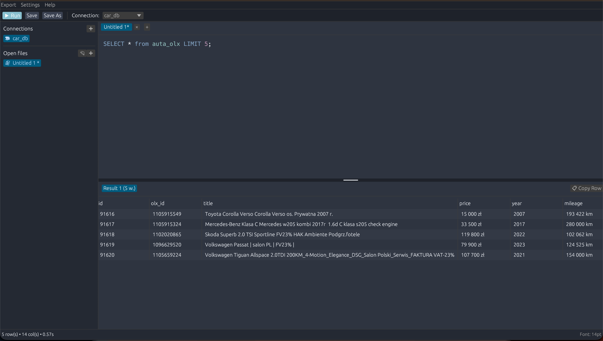

# SQL Editor

A fast, ultra-lightweight, native, and cross-platform SQL editor built with **Rust** and **egui / eframe**. 
Designed for maximum performance and usability, it allows you to run queries, manage multiple SQL files, and export results seamlessly.



## Features

- **Cross-platform**: Native support for Windows, macOS (Apple Silicon & Intel), and Linux.
- **Database Support**: SQLite (built-in native engine via `rusqlite`), PostgreSQL (native `postgres`), MySQL / MariaDB (native `mysql`), Oracle Database, Microsoft SQL Server (MS SQL), and Google BigQuery.
- **Syntax Highlighting**: Fast, regex-based SQL syntax tokenizer that can be toggled in Settings and automatically handles large files.
- **Resizable Splitter**: Smooth draggable vertical splitter bar between the editor and results, allowing you to easily stretch and resize the editor up and down.
- **SQL Autocomplete**: Context-aware autocompletion for SQL keywords, functions, tables, and columns from the active database connection. Supports dot notation (`table.column` or `alias.column`), clause context detection (`FROM`, `JOIN`, `SELECT`, `WHERE`), navigation with `↑`/`↓`, and insertion with `Enter` or `Tab` while keeping editor focus.
- **Multi-tab Editing**: Open and manage multiple SQL files simultaneously with unsaved modification indicators (`*`).
- **Persistent Connections**: Securely stores your database connections with encrypted passwords (100% backward-compatible with existing configuration files).
- **Large Data Handling**: High-performance virtual scrolling results table capable of smoothly rendering and scrolling up to 50,000+ rows at 60+ FPS without UI freezes.
- **Multi-query Results**: Run semicolon-separated statements and inspect each result in its own dedicated result tab (e.g., `Zapytanie 1 (10 w.)`, `Zapytanie 2 (5 w.)`).
- **Result Export**: Export query results as CSV, JSON, XLSX (Excel), or Markdown from the Export menu.
- **Result Row & Cell Copying**: Easily copy data from the results table. Click on any row and press `📋 Kopiuj wiersz`, double-click any cell to copy its value immediately, or right-click to copy as Cell Value, TSV, CSV, or with Headers.
- **Editor Zoom**: Resize the editor font dynamically using `Ctrl+Scroll` (or `Cmd+Scroll` on macOS) or adjust the font size slider with live preview in Preferences.
- **Update Checker**: Automatic update notifications and on-demand check via `Pomoc -> Sprawdź aktualizacje…`. Transparently displays current installed version and latest GitHub release, changelog/release notes, and offers direct one-click download of the recommended installer for your OS (MSI for Windows, PKG for macOS, AppImage for Linux).
- **Connection Test**: Test database connectivity from the connection dialog before saving.
- **Clear NULL Values**: NULL values are highlighted distinctly in italics instead of appearing as empty cells.
- **Themes & Customization**: Customize the look and feel in `Ustawienia -> Preferencje… -> 🎨 Motywy (Themes)`. Choose from 7 built-in presets (Dark Default, Dracula, One Dark Pro, Monokai, Nord, Solarized Dark, GitHub Light) or customize UI colors (editor background, sidebar panels, toolbar/headers, text color, accent button) with color pickers and live SQL preview. The editor background seamlessly matches the active theme across the entire surface.
- **Multilingual Interface**: Full interface translation supporting Polish (Polski), English, German (Deutsch), and Spanish (Español) with instant live language switching in Settings.
- **Preferences**: Toggle interface language, warnings for SELECT statements without LIMIT, SQL syntax highlighting, SQL autocomplete, editor font size, theme presets, and separate result tabs from the Settings menu.
- **Keyboard Shortcuts**: 
  - `Ctrl+Enter` / `Cmd+Enter` – Run current query or editor contents
  - `F5` – Run current query or editor contents
  - `Ctrl+S` / `Cmd+S` – Save file
  - `Ctrl+Shift+S` / `Cmd+Shift+S` – Save as…
  - `Ctrl+O` / `Cmd+O` – Open SQL file
  - `Ctrl+T` / `Cmd+T` – New tab
  - `Ctrl+W` / `Cmd+W` – Close active tab
  - `Ctrl+E` / `Cmd+E` – Export results to CSV
  - `Ctrl+Scroll` / `Cmd+Scroll` – Zoom editor font size in/out
  - `Double-click` (on result cell) – Copy cell value to clipboard
  - `Right-click` (on result cell/row) – Context menu to copy cell, row as TSV/CSV, or with headers
  - `Right-click` (on connection) – Edit or delete connection
  - `↑` / `↓` – Navigate autocomplete suggestions
  - `Enter` / `Tab` – Insert selected autocomplete suggestion
  - `Esc` – Close autocomplete popup

## Installation

### Run from source
1. Clone the repository:
   ```bash
   git clone https://github.com/Mixo123/SQL-Editor.git
   cd SQL-Editor
   ```

2. Run the application using Cargo:
   ```bash
   cargo run --release
   ```

3. Run the automated test suite:
   ```bash
   cargo test
   ```

## Pre-built Binaries

Check the [Releases](https://github.com/Mixo123/SQL-Editor/releases) page for ready-to-use packages:
- **Windows**:
  - `sql-editor-installer.msi` – Standard Windows Installer that installs to `Program Files`, adds shortcuts to the **Desktop** and **Start Menu**, and includes official application icons.
  - `sql-editor-windows-portable.zip` – Standalone portable version (no installation required).
- **macOS**:
  - `sql-editor-macos-installer.pkg` – **(Recommended)** Native macOS Package installer. Automatically installs to `/Applications` and removes Gatekeeper quarantine restrictions.
  - `sql-editor-macos.dmg` – Drag & drop disk image (includes `Fix-macOS-Gatekeeper.command` helper).
- **Linux**:
  - `sql-editor-x86_64.AppImage` – Standalone portable executable.
  - `.deb` – For Debian, Ubuntu, Linux Mint, etc. (includes desktop and icon integration).
  - `.rpm` – For Fedora, RHEL, openSUSE.

---

## Security, Antivirus & SmartScreen Notes (FAQ)

### Why does macOS or Windows show a virus / threat warning?

1. **macOS Gatekeeper & Apple Developer ID**:
   Apple requires developers to pay an annual Apple Developer subscription ($99/year) and notarize binaries on Apple servers. Open-source software distributed without a paid Apple certificate triggers Apple's Gatekeeper warning (especially on **macOS 15 Sequoia / Sonoma**):
   > *"SQL Editor can't be opened because Apple cannot check it for malicious software."* or *"SQL Editor will damage your computer."*

   **All releases are 100% safe**, open source, and built transparently from source code in [GitHub Actions](https://github.com/Mixo123/SQL-Editor/actions).

2. **Windows Defender SmartScreen**:
   Windows blocks newly downloaded files from the internet if they lack an expensive commercial Extended Validation (EV) certificate. Because this is a compiled, standalone native Rust executable without external runtime wrappers, it is lightweight, fast, and free of generic heuristic false positives.

---

### How to install and run on macOS:

#### Method 1: Use the `.pkg` installer (Recommended, automatic)
1. Download `sql-editor-macos-installer.pkg` from the [Releases](https://github.com/Mixo123/SQL-Editor/releases) page.
2. Open the installer and follow the on-screen steps.
3. The package automatically installs the app to `/Applications` and strips macOS quarantine flags. You can then open SQL Editor directly from Launchpad or Applications without Gatekeeper interruptions!

#### Method 2: Allow in System Settings (macOS 15 Sequoia / Sonoma)
On macOS 15 Sequoia, Apple removed the context-menu *Right-Click -> Open* bypass. Instead:
1. Try to open `SQL Editor` (macOS will show a security prompt – click *Cancel* or *Done*).
2. Open **Apple menu () -> System Settings**.
3. Navigate to **Privacy & Security**.
4. Scroll down to the **Security** section – you will see a message: *"SQL Editor was blocked from use because it is not from an identified developer"*.
5. Click **Open Anyway** and confirm with your password or Touch ID.

#### Method 3: Terminal Command (Instant unquarantine)
Open **Terminal** and run:
```bash
xattr -cr "/Applications/SQL Editor.app"
```
Then launch SQL Editor normally.

---

### How to run on Windows:
- When the blue **"Windows protected your PC"** (SmartScreen) popup appears:
  1. Click **"More info"**.
  2. Click **"Run anyway"**.
- If the downloaded `.msi` or `.zip` file is blocked in File Explorer:
  - Right-click the file -> **Properties** -> check **Unblock** at the bottom -> click **OK**.
  - Or in PowerShell: `Unblock-File .\sql-editor-installer.msi`.

---

### How to run on Linux (.AppImage):
After downloading, grant execution permissions:
```bash
chmod +x sql-editor-x86_64.AppImage
./sql-editor-x86_64.AppImage
```
